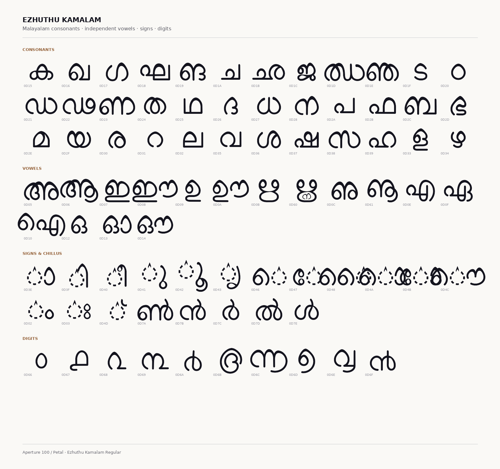

Ezhuthu Kamalam Font Family
===========================


**Ezhuthu Kamalam** is a Malayalam display typeface that treats the script's
loops as thresholds. Malayalam is a script of round counters and open curls;
Kamalam turns each one into a **lotus gateway**. At one end of its variable
axis the loop is the classic round form; at the other, its crown rises into a
soft petal. The transformation is not a decorative filter — it is a real
OpenType variation axis, interpolated from point-compatible outlines.

The family was designed for the large gesture: headlines, wordmarks, posters,
title cards, brand systems and screens where Malayalam should feel
contemporary without losing its roots. It is also comfortable in text, where
the petal crowns settle into a quiet, readable rhythm.

The typeface is built on the **Manjari** skeleton by Santhosh Thottingal and
Swathanthra Malayalam Computing, used under the SIL Open Font License. The
aperture engine, variable axis, spectrum build, metrics and specimens are new
work by the Ezhuthu Project Authors.

The Aperture Axis
-----------------


Every counter in Ezhuthu Kamalam can open from a classic round loop
(`APER 0`) to a pointed lotus gateway (`APER 100`). The axis is exposed as
`APER` in the variable fonts and has five named stops:

| APER | Name | Character |
|---:|---|---|
| 0 | Round | The classic Manjari loop |
| 25 | Quarter | A first lift at the crown |
| 50 | Bloom | The gateway begins to open |
| 75 | Three-quarters | A clear petal silhouette |
| 100 | Petal | The full lotus display cut (default) |


The two masters share the same point topology, so every intermediate value is
a designed shape and HarfBuzz shaping is identical at every stop. The axis
changes the counters and crowns, never the glyph sequence, the spacing or the
kerning.

The Spectrum
------------


**Ezhuthu Kamalam Spectrum** carries a blue → orange gradient inside the font
itself with COLRv1 and CPAL. Blue sits at the crown, orange near the baseline
and gold in the descenders, so a paragraph reads as one continuous field
rather than a set of separately coloured letters. Both Regular and Bold
Spectrum builds are included.

The spectrum is an homage to the lotus-and-gateway visual language of
[Sarvam AI](https://www.sarvam.ai/brand). This project is independent and is
not affiliated with or endorsed by Sarvam AI.

In Context
----------

The same fonts, the same axis, the same spectrum — applied to the kinds of
surfaces a contemporary Malayalam typeface has to live on.

| | |
|---|---|
|  |  |
|  |  |


Character Set
-------------



Ezhuthu Kamalam covers the complete Malayalam block plus Latin:

- 36 consonants, 16 independent vowels, all vowel signs and chillus
- Common conjuncts, reph forms, ya/va post-base signs
- Malayalam digits ൦–൯ and historical numerals ൰–൵
- Rare letters (ഩ ഺ ഽ ൏), chandrabindu, visarga, virama
- Latin uppercase/lowercase, digits, punctuation and common accents
- **918 glyphs** in Regular, **912** in Bold

The Family
----------

| File | What it is |
|---|---|
| `fonts/EzhuthuKamalam-Regular.ttf/.woff2` | Variable Regular, `APER` 0–100 (default 100) |
| `fonts/EzhuthuKamalam-Bold.ttf/.woff2` | Variable Bold, `APER` 0–100 (default 100) |
| `fonts/EzhuthuKamalam-Spectrum.ttf/.woff2` | Variable Bold + COLRv1 spectrum |
| `fonts/EzhuthuKamalam-SpectrumRegular.ttf/.woff2` | Variable Regular + COLRv1 spectrum |
| `fonts/EzhuthuKamalam-Round.ttf/.woff2` | Static `APER 0` instance |
| `fonts/EzhuthuKamalam-Petal.ttf/.woff2` | Static `APER 100` instance |
| `fonts/EzhuthuKamalam-BoldPetal.ttf/.woff2` | Static Bold `APER 100` instance |
| `proofs/EzhuthuKamalam-Specimen.pdf` | Vector PDF specimen |
| `specimen/index.html` | Interactive specimen (fonts embedded) |

Downloading the font files
--------------------------

The latest TTF and WOFF2 builds live in [`fonts/`](fonts/). The vector PDF
specimen is in [`proofs/EzhuthuKamalam-Specimen.pdf`](proofs/EzhuthuKamalam-Specimen.pdf).
The interactive specimen is [`specimen/index.html`](specimen/index.html);
open it directly, or serve it with:

```bash
make serve   # http://localhost:8000
```

Using the font
--------------

```css
@font-face {
  font-family: "Ezhuthu Kamalam";
  src: url("EzhuthuKamalam-Regular.woff2") format("woff2");
  font-weight: 400;
}

.bloom {
  font-family: "Ezhuthu Kamalam";
  font-variation-settings: "APER" 100; /* 0 = round, 100 = petal */
}
```

```python
# HarfBuzz / uharfbuzz
font.set_variations({"APER": 65})
```

For the colour build, use `EzhuthuKamalam-SpectrumRegular` or
`EzhuthuKamalam-Spectrum`. Clients with COLRv1 support paint the gradient;
clients without it fall back to the monochrome outlines.

Building from source
--------------------

The build is Python + fontTools + varLib + COLRv1:

```bash
make venv       # create .venv and install dependencies
make kamalam    # build masters, variable fonts, Spectrum, static instances
make test       # shaping, variation and colour tests
make proofs     # specimen PNGs, GIF and the interactive HTML
make pdf        # vector PDF specimen (needs Playwright + Chromium)
make qa         # fontbakery on Regular and Bold
```

Sources live in `sources/base/` (Manjari) and the aperture engine in
`tools/kamalam.py`. The build is reproducible: repeated runs produce
byte-identical fonts. Design and engineering notes are in
[NOTES.md](NOTES.md).

Testing and QA
--------------

- HarfBuzz shaping across `APER 0`, `50` and `100` — identical glyph sequences
- Full Malayalam block coverage, consonants × signs, conjunct fallback and
  anusvara combinations — no `.notdef`, no accidental dotted circles
- Fontbakery universal: **0 FAIL** on Regular and Bold (two documented
  custom-axis/Latin exceptions — see [NOTES.md](NOTES.md))
- COLRv1 spectrum and the live `APER` slider verified in Chromium 156
- Byte-identical repeat builds

License
-------

Ezhuthu Kamalam is licensed under the **SIL Open Font License v1.1**
(<http://scripts.sil.org/OFL>). See [OFL.txt](OFL.txt).

The base skeleton is **Manjari**, Copyright 2018 The Manjari Project Authors
(<https://gitlab.com/smc/fonts/manjari>), also under the SIL Open Font
License 1.1. The aperture engine, variable axis, Spectrum builds and specimens
are Copyright 2026 The Ezhuthu Project Authors.

The legacy v0.2 from-scratch parametric draft is preserved in
[`legacy/`](legacy/) and in `tools/glyphs_ml.py`.

Credits
-------

- **Design, aperture engine, variable font, Spectrum, specimens:** Ezhuthu
  Project Authors
- **Base skeleton:** Santhosh Thottingal and Swathanthra Malayalam Computing
- **Legacy v0.2 shaping engine:** adapted from
  [Nupuram](https://gitlab.com/smc/fonts/Nupuram) by Santhosh Thottingal / SMC
  (MIT)
- **Sarvam inspiration:** the blue → orange spectrum and the gateway/lotus
  language are an homage to [Sarvam AI](https://www.sarvam.ai/brand)

Getting involved
----------------

Bug reports, glyph requests and feature suggestions are welcome. Open an
issue in the repository or send a pull request against the `tools/` and
`sources/` directories. Please run `make test` and `make qa` before sending a
contribution.

If you use Ezhuthu Kamalam in a project, a small credit — “Typeface: Ezhuthu
Kamalam” — is appreciated.
