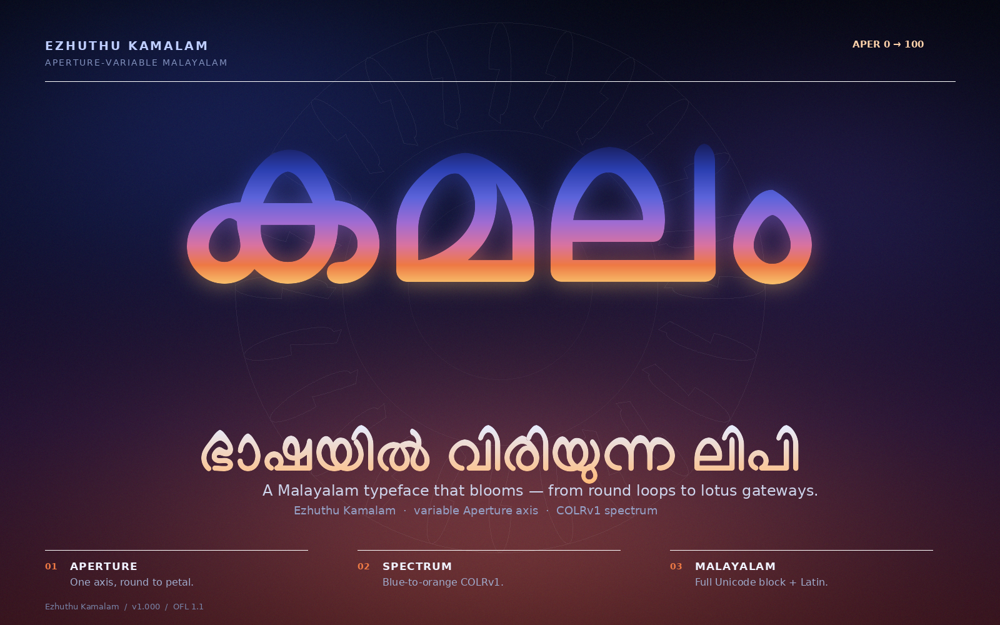
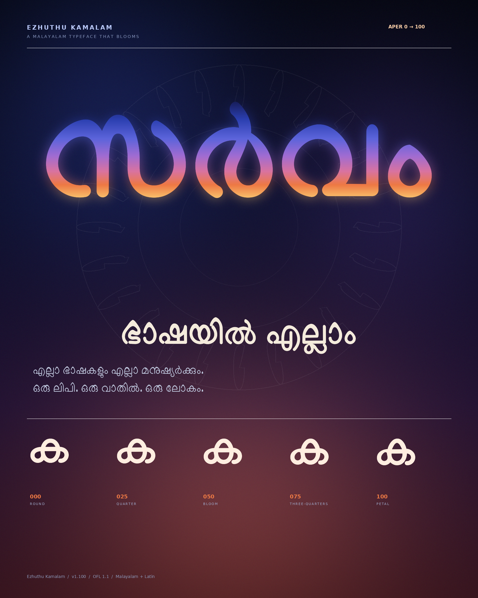
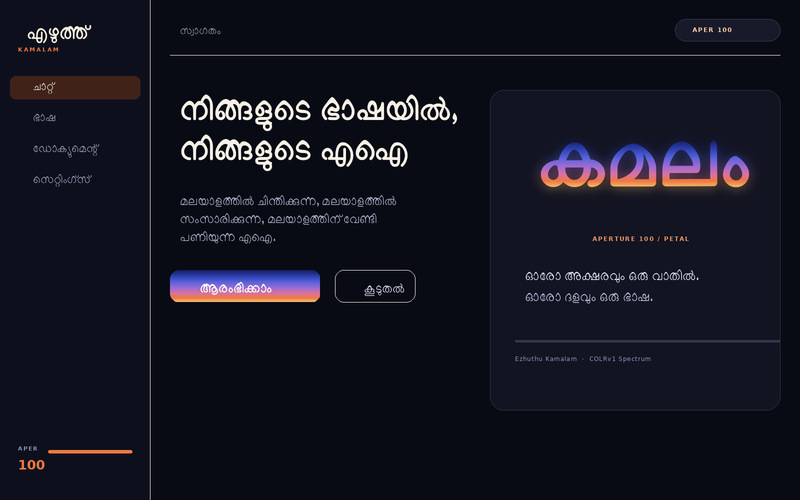
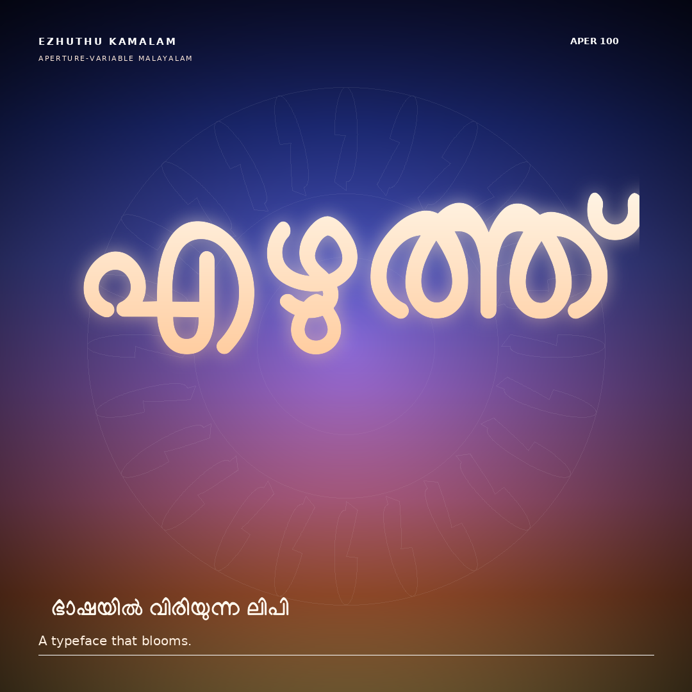
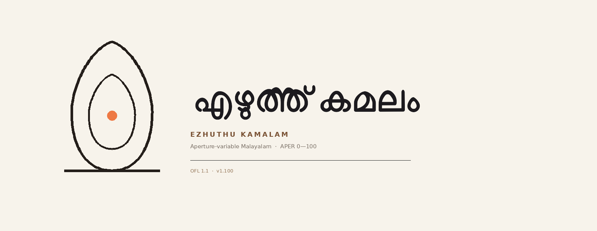

# Ezhuthu Kamalam (എഴുത്ത് കമലം)

**A Malayalam typeface that blooms — from round loops to lotus gateways.**



Ezhuthu Kamalam is an **aperture-variable Malayalam display family**. Every loop
and arch in the script is treated as a threshold: at `APER 0` it is a classic
round Malayalam loop; at `APER 100` its crown rises into a soft lotus point.
The whole transformation is exposed as a real OpenType variation axis, so the
design can move continuously between the two poles — not as a filter, but as
interpolated outlines.

On top of that, the **Spectrum** build carries a blue → orange
[COLRv1](https://learn.microsoft.com/en-us/typography/opentype/spec/colr)
gradient inside the font itself, a direct homage to
[Sarvam's](https://www.sarvam.ai/brand) gateway/lotus visual language.

> Status: **v1.000 — first Kamalam release.** Full Malayalam block + Latin,
> working HarfBuzz shaping, variable `APER` axis, and a COLRv1 colour companion.
> Fontbakery universal: **0 FAIL** on Regular and Bold (two documented
> custom-axis/Latin exceptions — see [NOTES.md](NOTES.md)); COLRv1 verified in
> Chromium 156.

---

## Why it is different

| | |
|---|---|
| **Aperture axis** | `APER 0→100` interpolates every counter and crown between a round loop and a lotus gateway. This is a new design axis for Malayalam. |
| **Point-compatible masters** | Both extremes are warped from the *same* outlines; no topology changes, so every intermediate value is a designed shape and shaping stays identical. |
| **COLRv1 spectrum** | A second build paints each glyph with a clipped linear gradient (`PaintGlyph` → `PaintLinearGradient`). Blue at the crown, orange at the baseline, gold in the descenders. |
| **Full script + Latin** | 918 glyphs (Regular) / 912 (Bold), all Malayalam consonants, vowels, signs, chillus, digits, historical numerals, common conjuncts, and Latin. |
| **Open** | SIL Open Font License 1.1. The skeleton is Manjari by Santhosh Thottingal / SMC; the aperture engine and Spectrum build are new. |

### The five stops


`Round` → `Quarter` → `Bloom` → `Three-quarters` → `Petal`.


The axis is real outline interpolation — every frame is a designed shape, and
the shaping is identical at every value.

### The spectrum


`Ezhuthu Kamalam Spectrum` is a variable Regular + Bold build with COLRv1/CPAL tables.
The gradient is defined once per glyph in font units, so a paragraph reads as
one continuous field rather than a set of separately coloured letters. In
applications without COLRv1 support the font falls back to its monochrome
outlines.

### In context

| | |
|---|---|
|  |  |
|  |  |



The poster, editorial, product UI, social card and lockup are generated from
the same fonts and the same aperture logic — not mocked up by hand.

---

## Files

```
fonts/
  EzhuthuKamalam-Regular.ttf/.woff2    variable Regular, APER 0–100 (default 100)
  EzhuthuKamalam-Bold.ttf/.woff2       variable Bold,    APER 0–100 (default 100)
  EzhuthuKamalam-Spectrum.ttf/.woff2         variable Bold + COLRv1 blue→orange spectrum
  EzhuthuKamalam-SpectrumRegular.ttf/.woff2  variable Regular + COLRv1 spectrum
  EzhuthuKamalam-Round.ttf/.woff2      static APER 0 instance
  EzhuthuKamalam-Petal.ttf/.woff2      static APER 100 instance
  EzhuthuKamalam-BoldPetal.ttf/.woff2  static Bold APER 100 instance
sources/
  base/       Manjari Regular/Bold (the OFL skeleton, unmodified)
  masters/    generated round/petal masters + designspace files
specimen/
  index.html  self-contained specimen with fonts embedded (open directly)
proofs/       specimen PNGs and character sheets
legacy/       the v0.2 from-scratch parametric draft
tools/
  kamalam.py       aperture warp, masters, variable build, COLRv1 spectrum
  specimen.py      hero / axis / gradient / glyph-sheet PNG proofs
  specimen_html.py self-contained HTML specimen generator
  render.py        HarfBuzz shaping + FreeType raster proofs (shared)
tests/
  test_kamalam.py  axes, shaping across APER, coverage, colour tables
  test_font.py     legacy draft tests
```

## Build

```bash
# 1. dependencies (Python ≥ 3.11)
make venv

# 2. build the Kamalam family + Spectrum
make kamalam

# 3. tests
make test

# 4. specimen PNGs + self-contained HTML
make proofs
# open specimen/index.html, or:
make serve   # http://localhost:8000
```

The specimen has a live APER slider, an editable Malayalam demo line, a
load-time bloom animation, and a brand-application gallery. The fonts are
embedded in the HTML, so it works offline. A vector PDF is also available:
[`proofs/EzhuthuKamalam-Specimen.pdf`](proofs/EzhuthuKamalam-Specimen.pdf).

The build reads `sources/base/Manjari-Regular.ttf` and
`sources/base/Manjari-Bold.ttf`, scales them to 1000 UPM, generates the round
and petal masters, writes designspaces, builds the variable fonts with
`fontTools.varLib`, adds the STAT table, and compiles the COLRv1 Spectrum font.
WOFF2 versions are produced for every TTF.

## Using the axis

```css
/* Web */
@font-face {
  font-family: "Ezhuthu Kamalam";
  src: url("EzhuthuKamalam-Regular.woff2") format("woff2");
  font-weight: 400;
}
.bloom {
  font-family: "Ezhuthu Kamalam";
  font-variation-settings: "APER" 100; /* 0 = round, 100 = petal */
}
```

```python
# HarfBuzz / uharfbuzz
font.set_variations({"APER": 65})
```

## How the aperture engine works

For every counter (hole contour) the engine finds the nearest outer-contour
point and lifts the crown of the hole by a capped amount, producing a pointed
petal without ever breaking through the stroke. At the same time, local maxima
on the outer contour are sharpened with a smooth Gaussian field, so open
arches and peaks (in മ, ന, ത, …) join the same visual language. The operation
only moves existing TrueType points:

```python
petal_warp(font, hole_bump=110, peak_bump=40, sigma_f=0.28, pinch=0.055)
```

Because both masters share point topology, `varLib` can interpolate cleanly.
The COLRv1 build then wraps each glyph in a `PaintGlyph` whose fill is a
`PaintLinearGradient` clipped to the outline.

## Credits & license

- **Skeleton / base design:** [Manjari](https://gitlab.com/smc/fonts/manjari)
  by Santhosh Thottingal and Swathanthra Malayalam Computing, licensed under
  the SIL Open Font License 1.1. Copyright 2018 The Manjari Project Authors.
- **Aperture engine, variable axis, Spectrum build, specimen:** Ezhuthu Project
  Authors, 2026.
- **Legacy v0.2 draft:** parametric glyph code adapted in spirit from
  [Nupuram](https://gitlab.com/smc/fonts/Nupuram) (MIT) by Santhosh Thottingal;
  the shaping engine in `tools/malayalamfont.py` is vendored from Nupuram.
- **Font and sources:** SIL Open Font License 1.1 — see [OFL.txt](OFL.txt).
- **Sarvam note:** the blue → orange spectrum is an homage to Sarvam AI's
  visual language. This project is independent and is not affiliated with or
  endorsed by Sarvam AI.

## Roadmap

1. **Traditional orthography** companion (pre-1971 conjuncts) as a second
   variable family.
2. **Weight axis** (`wght`) alongside `APER`, built from point-compatible
   masters.
3. **Optical size** (`opsz`) and a text-optimised cut.
4. **COLRv1 variants:** a full-spectrum fill, a two-tone cut, and a "threshold"
   inline that traces the baseline.
5. **Fontbakery QA** and a web specimen with an animated axis.

## Legacy draft

The repository began as a from-scratch parametric Malayalam typeface
(`legacy/`, `tools/glyphs_ml.py`, `tools/shapes.py`). That v0.2 engineering
draft covered the full block and shaped correctly, but its letterforms were
still exploratory. It is kept for provenance and research; the Kamalam family
is the production release. Build it with `make legacy` and test it with:

```bash
.venv/bin/python tests/test_font.py legacy/fonts/Ezhuthu-Regular.ttf
```
