Kallar Multiscript Font Family
==============================

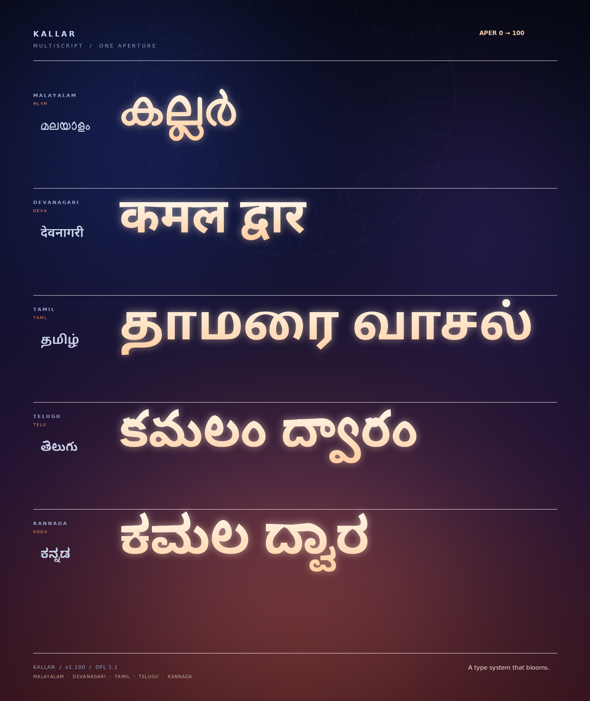

**Kallar** is a multiscript display type system built around one
idea: the counter as a **lotus gateway**. At one end of its variable axis a
loop is the classic round form; at the other, its crown rises into a soft
petal. The transformation is not a decorative filter — it is a real OpenType
variation axis, interpolated from point-compatible outlines.

The family began with Malayalam and now carries the same `APER` axis into
**Devanagari (Hindi, Marathi, Nepali), Tamil, Telugu and Kannada**. Each
script is a separate variable family because its shaping, glyph set and
vertical metrics are its own; together they share one axis, one set of named
stops, one Spectrum palette and one build pipeline.

The Malayalam branch is built on the **Manjari** skeleton by Santhosh
Thottingal and Swathanthra Malayalam Computing. The four new branches are
built on the corresponding **Noto Sans** skeletons by the Noto Project
Authors. All bases are used under the SIL Open Font License. The aperture
engine, variable axis, Spectrum builds, metrics and specimens are new work by
the Kallar Project Authors.

The project lives in the Ezhuthu repository:
[github.com/kurianbenoy/ezhuthu](https://github.com/kurianbenoy/ezhuthu).

Five Scripts, One Aperture
--------------------------

| Script | Family | Base skeleton | Script codepoints | Glyphs |
|---|---|---|---:|---:|
| Malayalam | `Kallar` | Manjari | full block | 918 / 912 |
| Devanagari (Hindi) | `Kallar Devanagari` | Noto Sans Devanagari | 201 | 1117 |
| Tamil | `Kallar Tamil` | Noto Sans Tamil | 72 | 576 |
| Telugu | `Kallar Telugu` | Noto Sans Telugu | 100 | 1247 |
| Kannada | `Kallar Kannada` | Noto Sans Kannada | 91 | 933 |

“Hindi” is written in Devanagari; the Devanagari family also covers Marathi,
Nepali and Sanskrit. The Tamil, Telugu and Kannada families each cover their
own script plus the Latin, digits and punctuation inherited from the base.

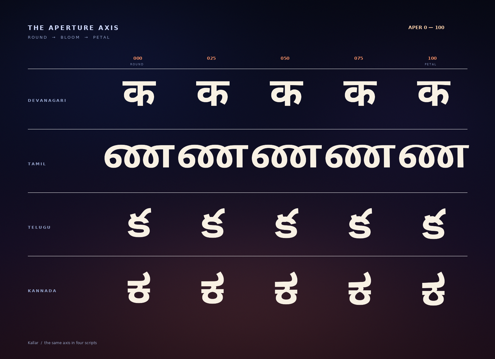

Each script has its own aperture profile, because the scripts do not share a
single counter grammar:

- **Devanagari** keeps the shirorekha dead straight. An absolute freeze at the
  headline means only the counters and the loops below it open into petals.
- **Tamil** uses a gentler hole-and-crown profile. Its counters are fewer and
  more open, so the petal is concentrated in the loops and the inner curves.
- **Telugu** and **Kannada** take the full hole-and-crown warp. Their round
  loops carry the lotus form most naturally.
- The warp is restricted to the script's **GSUB closure**, so Latin,
  punctuation and unrelated glyphs remain in the base style. The axis changes
  the script's counters, never its glyph sequence, spacing or kerning.

The per-script specimens show the full system:

| | |
|---|---|
| 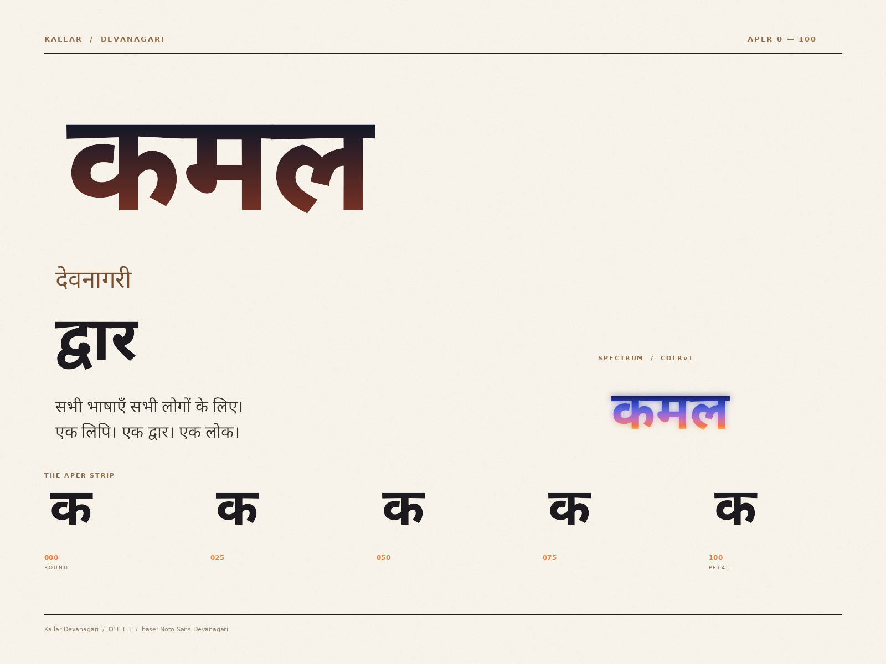 | 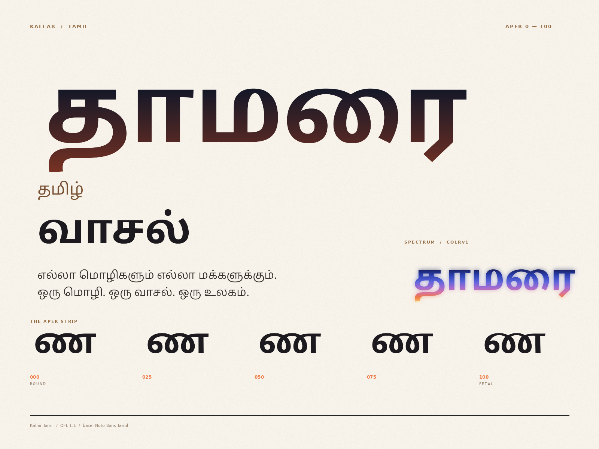 |
| 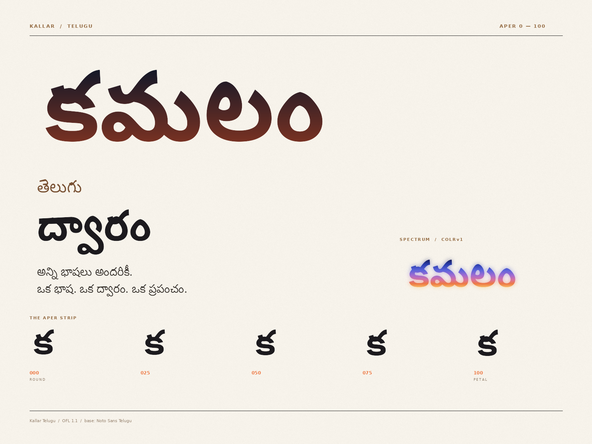 | 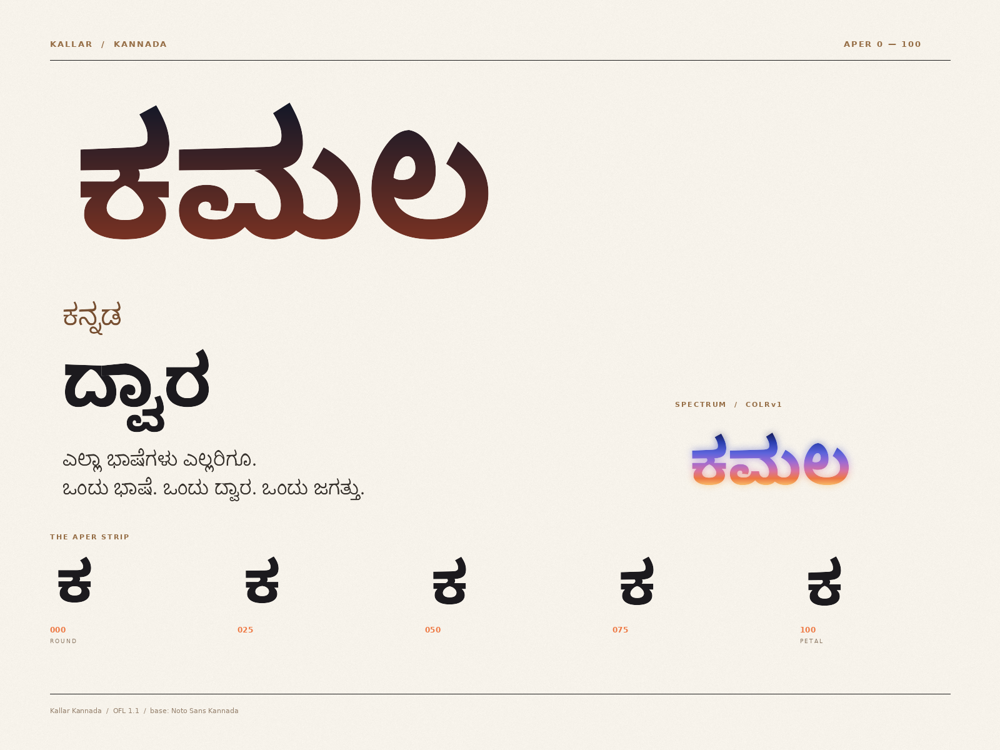 |

The Aperture Axis
-----------------

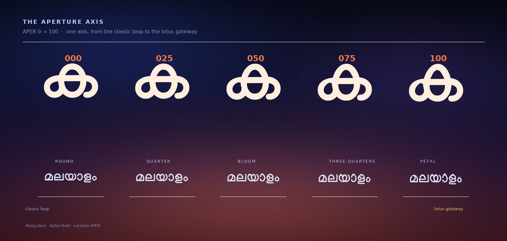

Every counter in Kallar can open from a classic round loop
(`APER 0`) to a pointed lotus gateway (`APER 100`). The axis is exposed as
`APER` in every variable font and has five named stops:

| APER | Name | Character |
|---:|---|---|
| 0 | Round | The classic loop |
| 25 | Quarter | A first lift at the crown |
| 50 | Bloom | The gateway begins to open |
| 75 | Three-quarters | A clear petal silhouette |
| 100 | Petal | The full lotus display cut (default) |

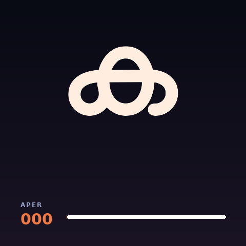

The two masters share the same point topology, so every intermediate value is
a designed shape and HarfBuzz shaping is identical at every stop. The axis
changes the counters and crowns, never the glyph sequence, the spacing or the
kerning.

The Spectrum
------------

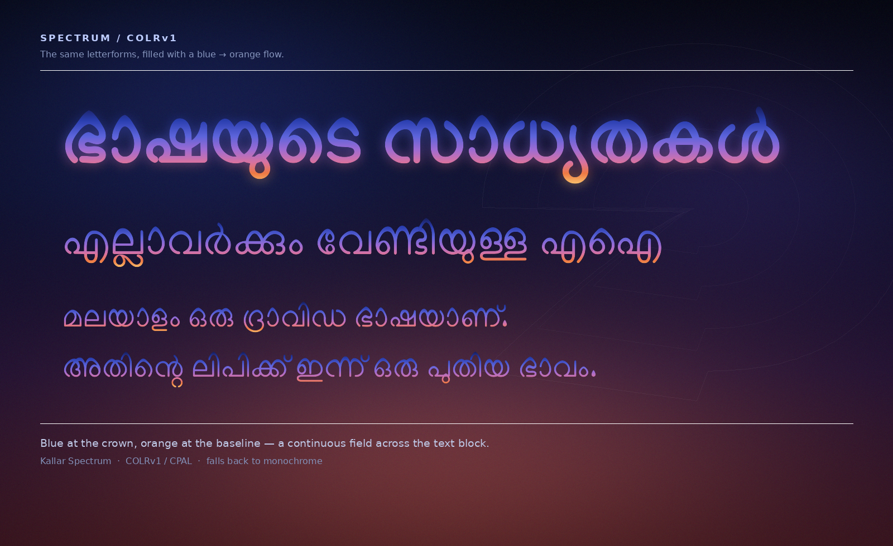

**Kallar Spectrum** carries a blue → orange gradient inside the font
itself with COLRv1 and CPAL. Blue sits at the crown, orange near the baseline
and gold in the descenders, so a paragraph reads as one continuous field
rather than a set of separately coloured letters. Regular and Bold Spectrum
builds ship for every script.

The spectrum is an homage to the lotus-and-gateway visual language of
[Sarvam AI](https://www.sarvam.ai/brand). This project is independent and is
not affiliated with or endorsed by Sarvam AI.

In Context
----------

The same fonts, the same axis, the same spectrum — applied to the kinds of
surfaces a contemporary Indian type system has to live on.

| | |
|---|---|
| 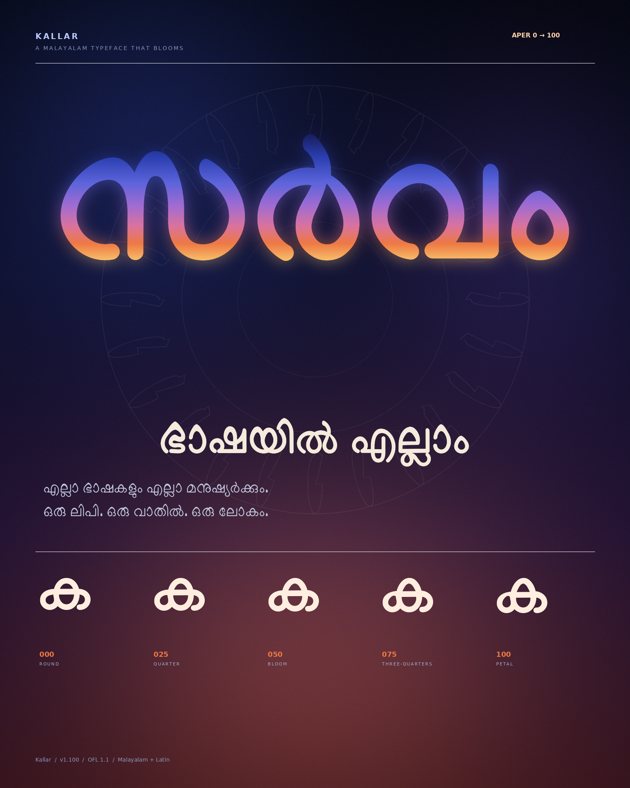 | 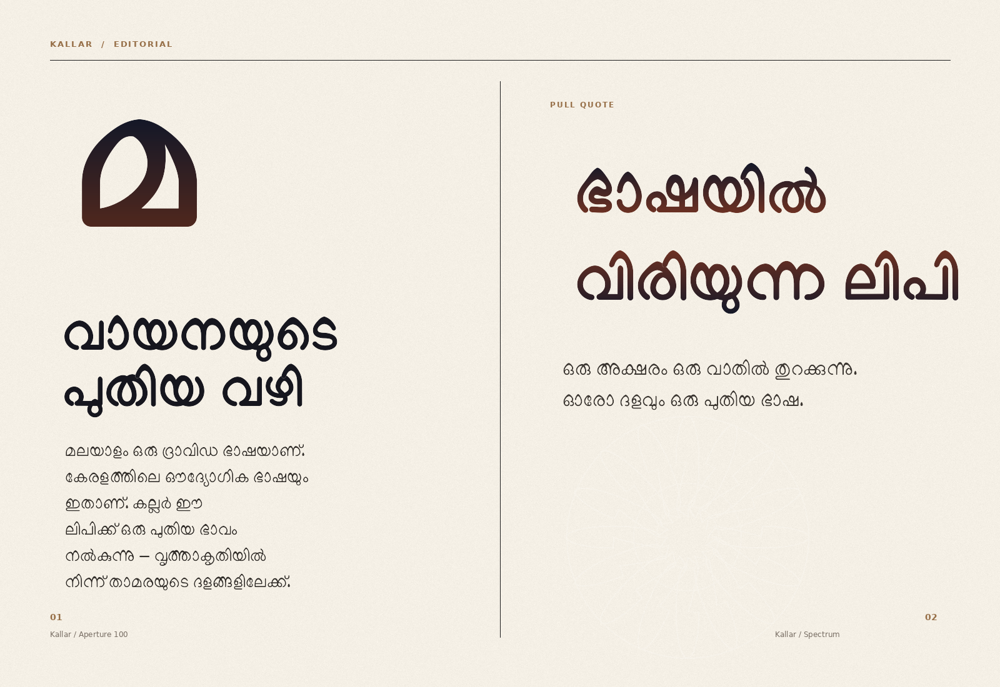 |
|  | 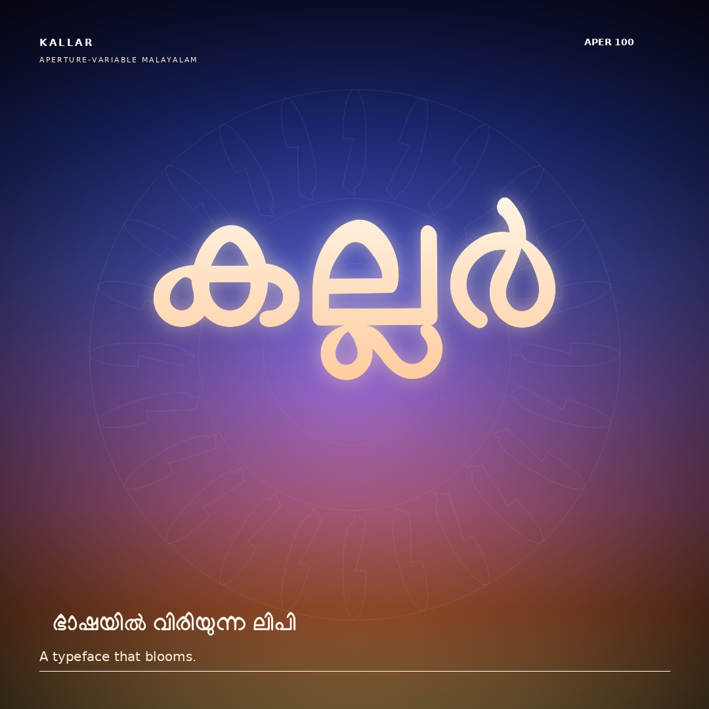 |

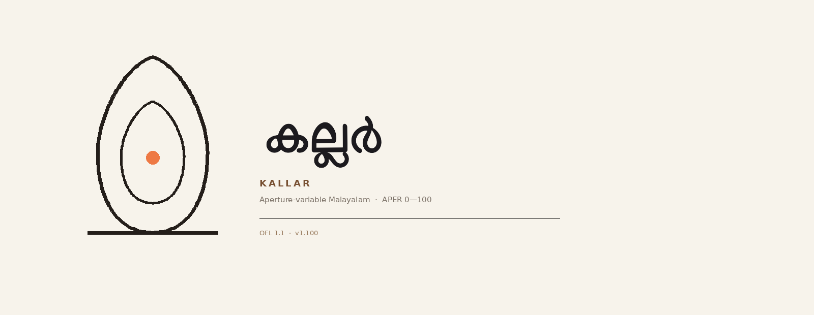

Character Set
-------------

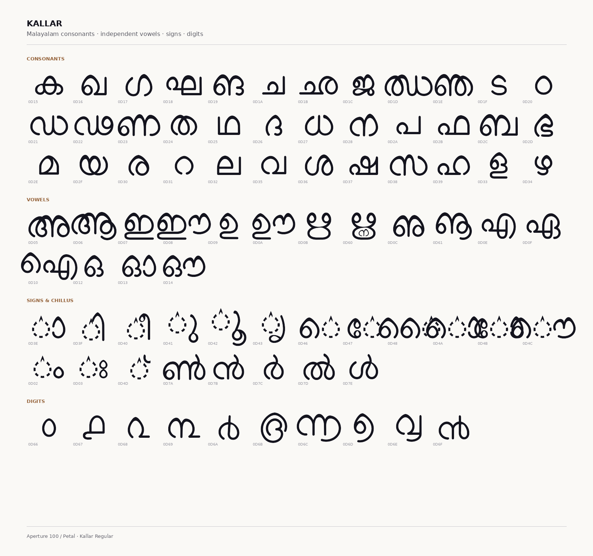

The Malayalam family covers the complete Malayalam block plus Latin:

- 36 consonants, 16 independent vowels, all vowel signs and chillus
- Common conjuncts, reph forms, ya/va post-base signs
- Malayalam digits ൦–൯ and historical numerals ൰–൵
- Rare letters (ഩ ഺ ഽ ൏), chandrabindu, visarga, virama
- Latin uppercase/lowercase, digits, punctuation and common accents
- **918 glyphs** in Regular, **912** in Bold

The multiscript families retain the full cmap and GSUB coverage of their
bases: Devanagari includes the Devanagari block, Devanagari Extended and the
Vedic extensions supported by Noto; Tamil, Telugu and Kannada include their
full blocks. Coverage is verified codepoint by codepoint in
`tests/test_multiscript.py`.

The Family
----------

The Malayalam family:

| File | What it is |
|---|---|
| `fonts/Kallar-Regular.ttf/.woff2` | Variable Regular, `APER` 0–100 (default 100) |
| `fonts/Kallar-Bold.ttf/.woff2` | Variable Bold, `APER` 0–100 (default 100) |
| `fonts/Kallar-Spectrum.ttf/.woff2` | Variable Bold + COLRv1 spectrum |
| `fonts/Kallar-SpectrumRegular.ttf/.woff2` | Variable Regular + COLRv1 spectrum |
| `fonts/Kallar-Round.ttf/.woff2` | Static `APER 0` instance |
| `fonts/Kallar-Petal.ttf/.woff2` | Static `APER 100` instance |
| `fonts/Kallar-BoldPetal.ttf/.woff2` | Static Bold `APER 100` instance |

Each new script ships the same seven styles:

| Family | Files |
|---|---|
| Kallar Devanagari | `fonts/KallarDevanagari-{Regular,Bold,Round,Petal,BoldPetal,Spectrum,SpectrumRegular}.{ttf,woff2}` |
| Kallar Tamil | `fonts/KallarTamil-{Regular,Bold,Round,Petal,BoldPetal,Spectrum,SpectrumRegular}.{ttf,woff2}` |
| Kallar Telugu | `fonts/KallarTelugu-{Regular,Bold,Round,Petal,BoldPetal,Spectrum,SpectrumRegular}.{ttf,woff2}` |
| Kallar Kannada | `fonts/KallarKannada-{Regular,Bold,Round,Petal,BoldPetal,Spectrum,SpectrumRegular}.{ttf,woff2}` |

Specimens:

| File | What it is |
|---|---|
| `specimen/index.html` | Interactive Malayalam specimen (fonts embedded) |
| `specimen/multiscript.html` | Interactive five-script specimen with a shared APER slider |
| `proofs/Kallar-Specimen.pdf` | Vector Malayalam PDF specimen |
| `proofs/Kallar-Multiscript-Specimen.pdf` | Vector multiscript PDF specimen |

Downloading the font files
--------------------------

The latest TTF and WOFF2 builds live in [`fonts/`](fonts/). The multiscript
specimen is [`specimen/multiscript.html`](specimen/multiscript.html); the
vector PDF is
[`proofs/Kallar-Multiscript-Specimen.pdf`](proofs/Kallar-Multiscript-Specimen.pdf).
Open the HTML directly, or serve both specimens with:

```bash
make serve   # http://localhost:8000
```

Using the font
--------------

```css
@font-face {
  font-family: "Kallar Devanagari";
  src: url("KallarDevanagari-Regular.woff2") format("woff2");
  font-weight: 400;
}

.deva {
  font-family: "Kallar Devanagari";
  font-variation-settings: "APER" 100; /* 0 = round, 100 = petal */
}
```

```python
# HarfBuzz / uharfbuzz
font.set_variations({"APER": 65})
```

For mixed-script copy, stack the families. The browser picks the first family
that supports each character; the Malayalam family handles Malayalam and the
shared Latin, and the script families fill in the rest:

```css
.multiscript {
  font-family:
    "Kallar",
    "Kallar Devanagari",
    "Kallar Tamil",
    "Kallar Telugu",
    "Kallar Kannada",
    sans-serif;
  font-variation-settings: "APER" 100;
}
```

For the colour builds, use `Kallar<Script>-SpectrumRegular` or
`Kallar<Script>-Spectrum`. Clients with COLRv1 support paint the
gradient; clients without it fall back to the monochrome outlines.

Building from source
--------------------

The build is Python + fontTools + varLib + COLRv1:

```bash
make venv            # create .venv and install dependencies
make kallar          # Malayalam: masters, variable fonts, Spectrum, instances
make multiscript     # Devanagari, Tamil, Telugu and Kannada families
make test            # shaping, variation and colour tests for all five scripts
make proofs          # specimen PNGs, GIF and both interactive HTML specimens
make pdf             # Malayalam vector PDF specimen
make pdf-multiscript # multiscript vector PDF specimen
make qa              # fontbakery on Malayalam Regular and Bold
make qa-multiscript  # fontbakery on the four new Regular/Bold families
```

Sources live in `sources/base/` (Manjari and the four Noto Sans variable
skeletons). The aperture engine is `tools/kallar.py`; the multiscript driver
is `tools/multiscript.py`. The build is reproducible: repeated runs produce
byte-identical TTF and WOFF2 files. Design and engineering notes are in
[NOTES.md](NOTES.md).

Testing and QA
--------------

- HarfBuzz shaping across `APER 0`, `50` and `100` for every script — identical
  glyph sequences and advances, no `.notdef` in any test case.
- Full cmap coverage of each base script, plus conjuncts, matras, reph forms
  and the Devanagari Vedic extensions supported by the base.
- Outline variation at the two extremes, and a guard that Latin stays
  untouched in the script families.
- Static Round/Petal instances differ from each other and carry the correct
  names; COLRv1/CPAL paint graphs are present in every Spectrum build.
- Fontbakery universal: **0 FAIL** on all eight multiscript Regular/Bold
  variable fonts (the same documented custom-axis and Bold/`fsSelection`
  exclusions as Malayalam, plus numeric STAT labels that stay inside the
  Windows 31-character limit; inherited Noto warnings are listed in
  [NOTES.md](NOTES.md)).
- Both HTML specimens and the COLRv1 gradient were verified in headless
  Chromium 156; the shared APER slider drives all four script families.
- Byte-identical repeat builds for `make kallar` and `make multiscript`.

License
-------

Kallar is licensed under the **SIL Open Font License v1.1**
(<http://scripts.sil.org/OFL>). See [OFL.txt](OFL.txt).

The Malayalam base skeleton is **Manjari**, Copyright 2018 The Manjari
Project Authors (<https://gitlab.com/smc/fonts/manjari>), under the SIL Open
Font License 1.1.

The Devanagari, Tamil, Telugu and Kannada base skeletons are the **Noto Sans**
families, Copyright 2022 The Noto Project Authors
(<https://github.com/notofonts>), under the SIL Open Font License 1.1. Their
upstream licences are kept in `sources/base/NotoSans*-OFL.txt`.

The aperture engine, variable axis, Spectrum builds, metrics and specimens are
Copyright 2026 The Kallar Project Authors.

The legacy v0.2 from-scratch parametric draft is preserved in
[`legacy/`](legacy/) and in `tools/glyphs_ml.py`.

Credits
-------

- **Design, aperture engine, variable fonts, Spectrum, specimens:** Kallar
  Project Authors
- **Malayalam base skeleton:** Santhosh Thottingal and Swathanthra Malayalam
  Computing
- **Devanagari, Tamil, Telugu and Kannada base skeletons:** The Noto Project
  Authors
- **Legacy v0.2 shaping engine:** adapted from
  [Nupuram](https://gitlab.com/smc/fonts/Nupuram) by Santhosh Thottingal / SMC
  (MIT)
- **Sarvam inspiration:** the blue → orange spectrum and the gateway/lotus
  language are an homage to [Sarvam AI](https://www.sarvam.ai/brand)

Getting involved
----------------

Bug reports, glyph requests and feature suggestions are welcome. Open an
issue in the repository or send a pull request against the `tools/` and
`sources/` directories. Please run `make test` and `make qa-multiscript`
before sending a contribution.

If you use Kallar in a project, a small credit — “Typeface: Kallar” — is
appreciated.
