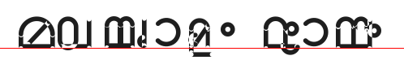

# Ezhuthu (എഴുത്ത്)

An **open-source Malayalam typeface built programmatically** — every glyph is
generated from exact parametric geometry (Python) instead of hand-drawn
sources, in the spirit of [SMC's Nupuram](https://gitlab.com/smc/fonts/Nupuram)
(reused under MIT with attribution for the shaping-engine code), published under the SIL OFL 1.1.

> Status: **v0.1 — engineering preview**. The complete Malayalam block
> (U+0D00–U+0D7F) is covered and OpenType shaping works end-to-end, but
> letterforms are still being refined.



## Highlights

- **Parametric outlines** — stem/arc/ring/cup primitives with round pen
  terminals (`tools/shapes.py`), letterform modules in `tools/glyphs_ml.py`
- **Full shaping stack** generated with fontFeatures (vendored Nupuram engine):
  - `akhn` — ZWJ chillus + 40 conjunct stacks
  - `pref`/`pres` — reph (്ര) ligatures incl. സ്ത്ര
  - `pstf` — ്യ / ്വ post-base forms
  - `psts` — conjoining vowel-sign ligatures (ു/ൂ/ൃ…)
  - `abvm`/`blwm` — mark attachment GPOS, `kern`, `calt` (നി wrap), `salt`/`aalt`
- **Complete glyphs**: 36 consonants, 16 independent vowels, vowel signs,
  chillus, digits ൦–൯, historical numeral marks (൰–൵), ഩ ഺ ഽ ൏ and friends,
  Latin digits + basic punctuation — all with correct anchors (`vc`, `bottom`, `right`)
- **HarfBuzz-verified**: `tests/test_font.py` asserts the exact shaped glyph
  sequence for chillus, conjuncts, reph, ൊ/ോ/ൌ decomposition, u-sign
  ligatures, dotted-circle paths and cmap coverage

## Build

```bash
sudo apt install python3.14-venv python3-dev        # or any python ≥ 3.11
python3 -m venv .venv
. .venv/bin/activate
pip install ufo2ft fonttools fontFeatures munch PyYAML uharfbuzz freetype-py pillow booleanOperations

# build UFO + TTF (and proof renders)
python tools/build.py            # Regular (sources/ufo/Ezhuthu-Regular.ufo, fonts/Ezhuthu-Regular.ttf)

# shape tests
python tests/test_font.py
```

## Repository layout

```
config.yaml          # font metadata + glyph classes/features config
tools/
  shapes.py          # parametric stroke engine (arcs, rings, capsules, dots)
  glyphs_ml.py       # Malayalam letterform designs (consonants, vowels, signs,
                     #   conjuncts, components)
  malayalamfont.py   # shaping engine (vendored from SMC Nupuram, MIT, ufoLib2-modernized)
  svgglyph.py        # unicode -> glyph-name mapping (from Nupuram)
  build.py           # discovers designs, composites, features, compiles
  render.py/sheet.py # proof renderers
  preview.py         # ASCII rasters for fast design iteration
sources/ufo/         # generated UFO sources
fonts/               # generated binaries (TTF / OTF / WOFF2)
proofs/              # rendered sample images vs reference fonts
tests/               # shaping + coverage assertions
```

## Roadmap

1. Letterform polish: match stroke rhythm of modern Malayalam type
   (per-glyph ASCII + rendered comparisons vs Manjari/Manjari-source refs)
2. Thin / Bold styles + variable font wght axis
3. OTF / WOFF2 builds, `Makefile`
4. Kerning refinement, contextual calt for chillu/avagraha spacing
5. Full fontbakery QA pass, web specimen page
6. LGC + Latin letter suite

## Credits & license

- Engine (feature generation, naming, kerning pipeline) adapted from
  [SMC Nupuram](https://gitlab.com/smc/fonts/Nupuram) — © Santhosh Thottingal and
  Swathanthra Malayalam Computing, MIT.
- All glyph artwork generated per this project's own parametric design tools.
- Font and sources licensed under the **SIL Open Font License 1.1** (see
  [OFL.txt](OFL.txt)).
